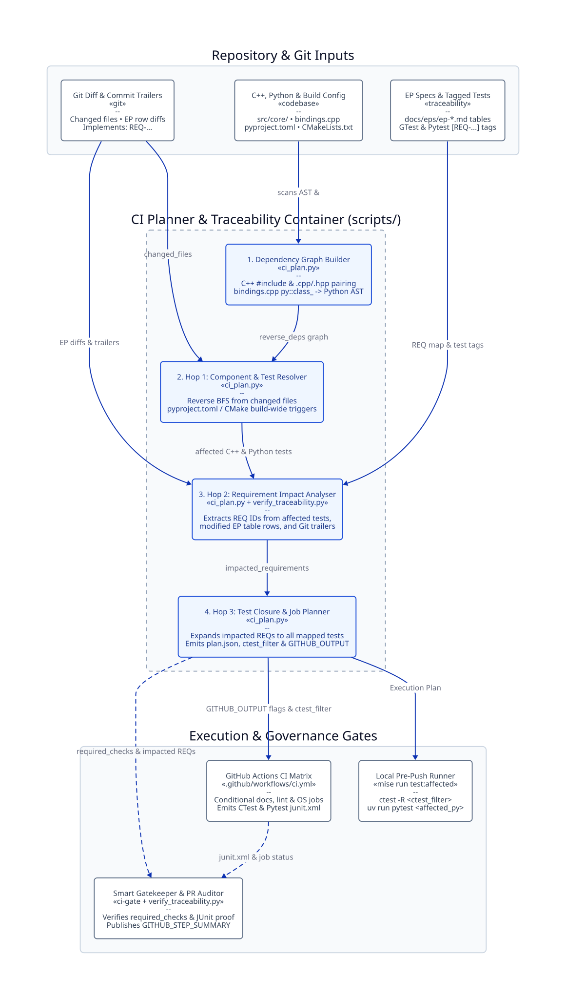

# EP-5: Specification-Driven Agentic Workflow and Traceability Infrastructure

* **Title:** Specification-Driven Agentic Workflow and Traceability Infrastructure
* **Author:** Paul Druce
* **Status:** Accepted
* **Target Version:** RFL v0.3.0
* **Date:** 2026-10-14

---

## 1. Multi-Phase Implementation Tracker

This proposal establishes a lightweight workflow and traceability infrastructure for human architects and autonomous AI coding agents.
The table below tracks the status of each implementation phase:

| Phase | Scope & Deliverables | Target Version | PR / Issue | Status |
| :--- | :--- | :--- | :--- | :--- |
| **Phase 1** | Standardise requirement namespacing and resolve ID collisions across EP-1 to EP-4 | `v0.3.0` | [#84](https://github.com/pauldruce/RFL/pull/84) | ✅ Complete |
| **Phase 2** | Implement zero-dependency traceability engine (`scripts/verify_traceability.py`) and `mise` tasks | `v0.3.0` | [#84](https://github.com/pauldruce/RFL/pull/84) | ✅ Complete |
| **Phase 3** | Integrate shift-left local Git hooks and CI Pull Request Step Summaries | `v0.3.0` | [#84](https://github.com/pauldruce/RFL/pull/84) | ✅ Complete |

---

## 2. Motivation, Goals & Non-Goals

### 2.1 Problem Statement & Agentic Context
Software development in `RFL` pairs a human physicist-architect with autonomous AI coding agents.
Without clear structural guardrails, agentic workflows exhibit three recurring failure modes:

1. **Requirement Collision & Ambiguity:** Un-namespaced identifiers (such as `REQ-001` appearing in EP-1, EP-3, and EP-4) prevent deterministic lookup across specifications and test suites.
2. **Traceability Drift:** Scientific invariants defined in Enhancement Proposals (EPs) drift from the C++ and Python test suites because no automated tool links specifications to executable tests.
3. **Slow Feedback Loops:** Relying solely on remote CI pipelines adds a 2-to-5-minute delay per iteration. Agents finish their active turn before discovering broken links, spelling errors, or missing test tags.

### 2.2 Goals
* **Deterministic Verification:** Provide a zero-dependency Python tool (`scripts/verify_traceability.py`) that maps Markdown requirements (`REQ-<SYS>-<NUM>`) to GoogleTest, Catch2, and Pytest test cases.
* **Domain-Aware Auditing:** Distinguish between unit-testable code/physics invariants (`ARCH`, `PHY`, `TRC`) and CI/packaging workflow rules (`CI`, `PKG`) to eliminate false-positive audit warnings.
* **Shift-Left Agentic Feedback:** Execute fast static checks in `.githooks/pre-commit` (< 1 second) and full test suites in `.githooks/pre-push` so agents self-correct within their active turn.
* **Low-Friction PR Governance:** Publish a clear Markdown traceability table and modified-test diff alert to `$GITHUB_STEP_SUMMARY` without blocking internal refactoring PRs.
* **Compliance with EP-3:** Ensure all traceability checks execute in under 200 ms, preserving the sub-120-second CI budget (`REQ-CI-001`).

### 2.3 Non-Goals
* Do not adopt heavyweight external ALM frameworks (Sphinx-Needs, OpenFastTrace, ReqIF, or Doorstop).
* Do not enforce rigid multi-commit Git history choreography (such as mandatory two-commit Red-Green git time-travel) that breaks during rebasing or interactive C++ debugging.
* Do not require cryptographic SHA-256 manifest files or special GitHub override labels to edit or add tests.
* Do not track auto-generated traceability matrix files in Git where they cause merge conflicts across branches.

---

## 3. Requirements & Operational Invariants

| Requirement ID | Requirement Summary | Lifecycle Status | Operational & Architectural Invariant |
| :--- | :--- | :--- | :--- |
| **REQ-TRC-001** | **Global Requirement Namespacing** | Phase 1 (Implemented) | Requirement IDs must conform to regex `^REQ-[A-Z]{2,4}-\d{3}[a-z]?$`. Subsystem codes: `ARCH` (Architecture), `PKG` (Packaging), `CI` (CI/CD), `PHY` (Physics), `TRC` (Traceability). |
| **REQ-TRC-002** | **Lifecycle & Domain Awareness** | Phase 1 (Implemented) | Requirement tables in Section 3 of all EPs must include four columns: `Requirement ID`, `Requirement Summary`, `Lifecycle Status`, and `Operational & Physical Invariant`. Test coverage audits evaluate unit-testable requirements (`ARCH`, `PHY`, `TRC`) marked `Implemented`. |
| **REQ-TRC-003** | **Zero-Dependency Traceability Engine** | Phase 2 (Implemented) | `scripts/verify_traceability.py` must use standard Python $\ge 3.10$ libraries only. Exit codes: 0 (pass), 1 (validation error), 2 (CLI usage error). Runs in under 200 ms. |
| **REQ-TRC-004** | **Multi-Framework Tag Support** | Phase 2 (Implemented) | The engine must extract tags from GoogleTest comments (`// [REQ-...]`), Catch2 tags (`[REQ-...]`), and Pytest test functions (`def test_*` via `@pytest.mark.req`, docstrings, or comments), ignoring non-test helper methods. |
| **REQ-TRC-005** | **Two-Hop Impact Planner & PR Summary** | Phase 3 (Implemented) | `scripts/ci_plan.py` computes affected tests and impacted requirements from C++ `#include` graphs, `pybind11` symbol ASTs, EP table diffs, and Git trailers (`plan.json`). `verify_traceability.py --check-pr` verifies JUnit XML execution and highlights modified test files in `$GITHUB_STEP_SUMMARY`. |
| **REQ-TRC-006** | **Shift-Left Local Git Hooks** | Phase 3 (Implemented) | `.githooks/pre-commit` executes CSpell, link validation, and `verify_traceability.py --audit` on staged changes in under 1 second. `.githooks/pre-push` runs `mise run pre-push` (`lint` + `test:affected`). |

---

## 4. Architecture Decision Records (ADRs) & Trade-offs

### 4.1 ADR-1: Custom Python Standard Library Tooling vs Heavyweight ALM Frameworks

| Criteria | Option A: External Tools (Sphinx-Needs / Doorstop) | Option B: Custom Standard Library Python Script (Selected) |
| :--- | :--- | :--- |
| **Dependencies** | Heavy (Requires Sphinx build or external Python packages) | **Zero (Standard Python 3 only, native to RFL)** |
| **Execution Time** | 5–30 seconds in CI | **< 200 ms (instant local feedback)** |
| **Markdown Fit** | Poor (Requires YAML files or rST directives) | **Native (Parses GitHub Flavoured Markdown tables directly)** |
| **Maintenance** | Vulnerable to upstream deprecation | **Complete repository ownership alongside existing scripts** |
| **Decision** | Rejected | **Selected (Option B)** |

*Rationale:* RFL follows lean development principles. Adding external documentation build chains violates `REQ-CI-001` and `REQ-CI-005`. Single-file Python scripts in `scripts/` mirror existing repository utilities (`scripts/check_links.py`, `scripts/verify_changelog.py`).

---

### 4.2 ADR-2: JUnit Execution Proof & Diff Visibility vs Git-Topology & SHA-256 Ceremonies

| Criteria | Option A: Two-Commit Git Choreography & SHA-256 Manifests | Option B: JUnit XML Verification & PR Test-Diff Visibility (Selected) |
| :--- | :--- | :--- |
| **C++ Iteration Ergonomics** | ❌ Poor (Fights interactive debugging, rebasing, and fixup commits) | ✅ **Optimal (Standard atomic commits across headers, source, and tests)** |
| **Test Addition Friction** | ❌ High (Adding a test or fixing a comment breaks SHA-256 seals) | ✅ **Zero (New tests require no manifest regeneration or PR labels)** |
| **Tamper Visibility** | Cryptographic hash failure on file change | **Explicit alert in `$GITHUB_STEP_SUMMARY` listing modified test files** |
| **Execution Proof** | Fragile git checkout gymnastics in CI | **Direct verification of CTest and Pytest JUnit XML results** |
| **Decision** | Rejected | **Selected (Option B)** |

*Rationale:* Enforcing multi-commit Red-Green git topology or SHA-256 test manifests introduces high rigidity and encourages agents to write compliance theatre (such as dummy stubs or trivial arithmetic tests). In RFL, a human architect reviews every pull request. Verifying that impacted and claimed requirements execute and pass in JUnit XML—while surfacing any modified existing test files directly in `$GITHUB_STEP_SUMMARY`—provides complete assurance with zero ceremonial overhead.

---

### 4.3 ADR-3: Two-Hop Component & Requirement Impact Planner vs Source Code Tagging

| Criteria | Option A: Tag Production `src/` Files with `REQ-` IDs | Option B: Two-Hop Graph via Tests & `pybind11` AST (Selected) |
| :--- | :--- | :--- |
| **Source Code Cleanliness** | ❌ Poor (Pollutes C++ headers and sources with governance tags) | ✅ **100% Clean (`src/` contains zero requirement tags or CI comments)** |
| **Cross-Language Bridge** | Manual `# +ci:depends_on` magic comments that rot | **Automatic (`bindings.cpp` symbol table + Python AST `rfl.<Symbol>`)** |
| **EP Spec Edit Detection** | Ignored by static YAML path filters | **Automatic (`git diff` on EP tables schedules mapped C++/Python tests)** |
| **CI Execution Speed** | Runs all tests on every code change | **Runs only affected CTest suites (`-R`) and affected Python test files** |
| **Decision** | Rejected | **Selected (Option B)** |

*Rationale:* Production code in `src/` should remain pure C++ and Python without requirement annotations or magic CI comments. Because unit tests sit between the production code they import/include and the `[REQ-...]` tags they verify, `scripts/ci_plan.py` infers requirement impact in three automatic hops:
1. **Hop 1 (`Code -> Affected Tests`):** Scans C++ `#include` graphs (pairing `.cpp` implementations with `.hpp` headers) and maps Python test ASTs (`rfl.<Symbol>`) through `src/python_bindings/bindings.cpp` (`py::class_<>`).
2. **Hop 2 (`Affected Tests + EP Diffs -> Impacted Requirements`):** Reads `[REQ-...]` tags from affected tests, plus any modified requirement rows in `docs/eps/ep-*.md` and `Implements: REQ-...` trailers.
3. **Hop 3 (`Impacted Requirements -> Full Requirement Test Closure`):** Schedules all C++ and Python test suites mapped to those impacted requirements in `plan.json` for the Smart Gatekeeper (`ci-gate`).

---

### 4.4 ADR-4: Shift-Left Local Git Hooks vs Remote-Only CI Gating

| Criteria | Option A: Remote CI Only | Option B: Shift-Left Dual Loop (Local Hooks + Remote CI) (Selected) |
| :--- | :--- | :--- |
| **Agent Feedback Latency** | 2–5 minutes per push | **< 1 second (instant stderr self-correction in local turn)** |
| **PR Commit Hygiene** | Poor (noisy retry commits) | **Optimal (clean commits verified before push)** |
| **Compute Consumption** | High (consumes remote runner minutes) | **Zero (local CPU cycles, < 200 ms for static audit)** |
| **Decision** | Rejected | **Selected (Option B)** |

*Rationale:* Wiring CSpell, `check_links.py`, and `verify_traceability.py --audit` into `.githooks/pre-commit` shifts verification left into the agent's inner loop. If an agent introduces a broken link, typo, or malformed requirement tag, `git commit` fails immediately in the terminal output, allowing the agent to self-correct in the same turn. `.githooks/pre-push` executes `mise run pre-push` (`lint` + `test:affected`) to guarantee affected component and requirement tests pass before code leaves the workstation.

---

## 5. Target Architecture & Workflow



*Figure 5.1: C4 component architecture of the CI Execution Planner and Two-Hop Impact Analyser (`scripts/ci_plan.py` and `scripts/verify_traceability.py`). Source script co-located at [`docs/eps/images/ep5_ci_planner_c4.d2`](images/ep5_ci_planner_c4.d2).*

### 5.1 The Contributor Lifecycle

```
1. SPECIFY (Human Architect)
   - Define or refine requirement in docs/eps/: REQ-<SYS>-<NUM>
   - Specify physical invariant and numerical tolerance

2. IMPLEMENT & TAG (Contributor / Agent)
   - Implement C++ / Python feature and unit tests (zero tags in src/)
   - Tag test cases with // [REQ-<SYS>-<NUM>] or @pytest.mark.req("REQ-...")
   - Local pre-commit hook verifies spelling, links, and traceability (< 1s)

3. VERIFY & PUSH (Local Pre-Push Gate)
   - Local pre-push hook runs `mise run pre-push` (lint + affected component/requirement tests)

4. PLAN, QUALIFY & MERGE (3-Tier CI & Human Review)
   - Tier 1 (`plan`): `scripts/ci_plan.py` outputs `plan.json` (affected tests & impacted REQs)
   - Tier 2 (Execution): Runs targeted CTest (`-R`) and Python suites, emitting JUnit XML
   - Tier 3 (`ci-gate`): Verifies all `required_checks` in `plan.json` succeeded
```

### 5.2 CLI Interface (`scripts/ci_plan.py` & `scripts/verify_traceability.py`)

```bash
# Inspect affected components, test suites, and impacted requirements (including uncommitted work)
mise run affected

# Output deterministic CI execution plan as JSON
mise run ci:plan

# Run C++ and Python unit tests strictly on affected components and impacted requirements
mise run test:affected

# Audit repository for duplicate IDs, orphaned tags, and testable coverage
python3 scripts/verify_traceability.py --audit

# Query requirement details, invariant, and mapped test cases
python3 scripts/verify_traceability.py --query REQ-ARCH-001

# Validate current PR branch against origin/main (impacted REQs, test diffs, JUnit XML)
python3 scripts/verify_traceability.py --check-pr
```

---

## 6. Verification Matrix & Quality Gates

| Verification Gate | Command / Target | Target Invariant |
| :--- | :--- | :--- |
| **Pre-Commit Hook** | `.githooks/pre-commit` | CSpell, markdown link checks, and `verify_traceability.py --audit` complete in < 1s. |
| **Pre-Push Hook** | `.githooks/pre-push` | Runs `mise run pre-push` (`lint` + `test:affected`) before pushing. |
| **CI Execution Planner** | `mise run ci:plan` | Computes affected C++/Python tests and impacted `REQ-` IDs in < 200 ms (`plan.json`). |
| **Static ID Audit** | `mise run lint:traceability` | All `REQ-` IDs are globally unique across EPs; zero orphaned test tags. |
| **Tool Unit Tests** | `python3 -m unittest discover -s scripts/tests` | Unit test coverage over EP tables, GTest/Catch2/Pytest extraction, `pybind11` AST bridge, and `plan.json`. |
| **CI Smart Gatekeeper** | `.github/workflows/ci.yml` (`ci-gate`) | Enforces all `required_checks` from `plan.json` and renders impact tables in `$GITHUB_STEP_SUMMARY`. |

